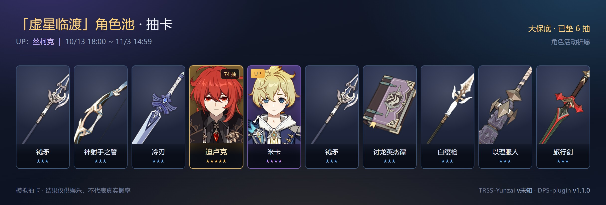
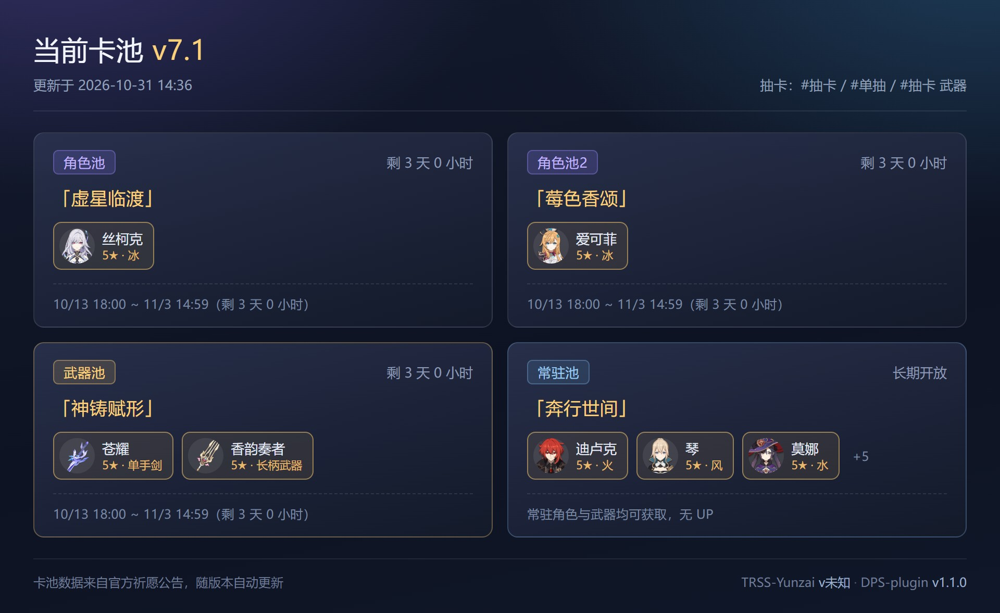

# 原神 DPS · 危战 · 抽卡 插件

Yunzai / TRSS-Yunzai 插件：原神配队 **DPS 榜** + **危战榜** + **模拟抽卡**，图片渲染。

数据来源：[mhydps.cn](https://www.mhydps.cn/)（榜单）｜ 米游社官方祈愿公告（卡池）



## 特性

- 🎴 **模拟抽卡**：角色池 / 武器池 / 常驻池，保底、大小保底、武器定轨全部还原
- 🔄 **卡池自动更新**：跟随官方祈愿公告，出新版本新角色**不用手动维护名单**
- 📜 **抽卡记录与统计**：出金率、平均抽数、歪率、群内欧皇榜
- 🖼 **图片渲染**：角色圆形头像、命座角标、金数、伤害/用时、B站视频入口
- 📊 **DPS 配队榜**：按角色查，支持翻页、金数上限筛选
- ⚔️ **危战榜**：按 boss 查，支持版本筛选（5.7 ~ 7.1）与低金筛选
- 👥 **头像复用 miao-plugin 本地图库**，不需要联网取头像
- ⏱ **5 分钟缓存**，避免频繁请求被 Cloudflare 拦

## 抽卡的优先级

`#抽卡` / `#单抽` / `#十连` / `#定轨` / `#卡池` 的 **priority 是 10**，排在这些插件前面：

| 插件 | 优先级 |
| --- | --- |
| 本插件 | **10** |
| Nwflower/flower-plugin（抽卡MOD） | 98（单抽）/ 99（十连·定轨） |
| genshin 自带抽卡 | 100 |

云崽按 priority **升序**执行，数值小的先用 ⇒ 装了本插件后这些指令都走这里，不需要停用原插件。
（且这些分支即使走到「次数用完 / 没权限 / 没数据」也会 `return true` 收口，不会再落到别的抽卡插件去。）



## 安装

### 前置条件

- 渲染后端：`puppeteer` 或 `shotium`（TRSS-Yunzai 自带）
- 建议安装 [miao-plugin](https://github.com/yoimiya-kokomi/miao-plugin) —— 提供角色头像。
  没装也能用，只是头像位置显示角色首字。

### 方式一：手动克隆（推荐，最稳）

在 **Yunzai 根目录**执行：

```bash
git clone https://github.com/ll-cn/DPS-plugin.git plugins/DPS-plugin
```

然后重启机器人。

### 方式二：机器人指令安装

装有 **earth-k-plugin**：

```
#安装插件 https://github.com/ll-cn/DPS-plugin.git
```

装有 **AQing-plugin**：

```
#阿晴安装插件 https://github.com/ll-cn/DPS-plugin.git
```

### ⚠️ 必须克隆整个仓库

插件依赖 `resources/` 下的 5 个 html 模板，**只放 `app/` 里的 js 是跑不出图的**
（机器人会回复「缺少模板文件」并告诉你缺哪一个）。

另外 `index.js` 是入口 —— 云崽的加载规则是「有 `index.js` 就只加载它」，
所以**不要删掉或改名 `index.js`**，否则插件不会被加载。

## 配置

配置文件：**`config/config.yaml`**，改完保存**即时生效**（不用重启）。
如果误删了它（或文件变成空的），**下次查询会自动重新生成**一份默认配置，不用担心跑不起来。
插件升级后**新增的配置项会自动补进你的 config.yaml**（已有的值和注释都保留，不会覆盖你的改动）。

```yaml
cacheTime: 300000   # 数据缓存时长(毫秒)，官方建议 ≥5 分钟
timeout: 25000      # 请求超时(毫秒)
imageScale: 2       # 出图清晰度倍数(1=原尺寸，2=两倍像素)
jpegQuality: 90     # 出图质量(0-100，越低图越小)
textOnly: false     # 只发文字不发图
perPage: 20         # 每页条数
maxPage: 30         # 最多翻到第几页
lowCost: 2          # 危战「低金」的金数上限
alias:              # 角色俗称 → 官方名
  少女: 哥伦比亚
  火神: 玛薇卡
dailyLimit: 10      # 每天可抽次数，十连算 1 次（0 = 不限）
refreshMinutes: 360 # 卡池自动刷新间隔(分钟)，0 = 只靠启动和过期触发
pityTip: true       # 抽卡卡片是否显示保底进度
```

## 指令

| 指令 | 说明 |
| --- | --- |
| `#dps帮助` | 查看全部指令（图片） |
| `#dps配队 <角色> [页数]` | 该角色的 DPS 配队榜，每页 20 条 |
| `#dps配队 <角色> N金` | 只看金数 ≤N 的配队 |
| `#dps风仙排行6金` | 俗称、词序都随意（风仙 = 薇斯纳） |
| `#dps危战` | 最新版本（7.1）的危战榜 |
| `#dps危战 <boss>` | 指定 boss，如 `#dps危战 游雪的护刃` |
| `#7.1危战第二间` | 按 版本号 + 第几间 查 |
| `#dps危战 <boss> 低金` | 只看低金配队（金数 ≤2） |
| `#dps危战 <版本号>` | 列出某版本的 boss，如 `#dps危战 7.0` |
| `#dps危战列表 [版本]` | 全部 boss（可按版本筛），带各 boss 条数 |
| `#dps视频 <名次>` | 取榜单第 N 条的 B 站视频链接 |
| `#dps刷新` | 重新拉取榜单数据（仅主人） |
| `#dps更新` | 更新插件版本（从 GitHub 拉取，仅主人） |
| `#dps强制更新` | 更新失败时用它：丢弃本地改动，强制拉取最新（仅主人） |
| `#dps更新日志` | 查看版本提交记录（合并转发） |

### 模拟抽卡

| 指令 | 说明 |
| --- | --- |
| `#抽卡` / `#十连` | 角色池十连（默认每天 10 次） |
| `#单抽` | 角色池单抽 |
| `#抽卡武器` | 武器池十连，可配合 `#定轨` 指定武器 |
| `#抽卡常驻` | 常驻池十连 |
| `#抽卡池2` | 当期第二个角色池 |
| `#卡池` | 当期四个卡池一览（图片） |
| `#定轨苍耀` | 武器池定轨（直接接武器名），定轨值满 2 必出 |
| `#模拟抽卡记录 [页码]` | 最近的抽卡记录（四星及以上） |
| `#模拟抽卡记录五星` | 只看五星历史 |
| `#模拟抽卡统计` | 出金率、平均抽数、歪率、各池垫抽 |
| `#欧皇榜` | 群内平均出金排行（满 20 抽上榜） |
| `#卡池更新` | 手动同步卡池与角色库（主人 / 群管） |

**抽卡概率**（还原游戏内机制，各池独立计数，角色池 1 与池 2 共享保底）：

| | 五星基础 | 软保底起点 | 硬保底 | UP 概率 |
| --- | --- | --- | --- | --- |
| 角色池 | 0.6% | 74 抽 | 90 抽 | 50%，歪了下次必中 |
| 武器池 | 0.7% | 63 抽 | 80 抽 | 75%，支持定轨 |
| 常驻池 | 0.6% | 74 抽 | 90 抽 | 无 UP |

四星 5.1%，每 10 抽必出。实测 100 万抽出金率 1.61%、平均 62.1 抽一个五星（官方约 1.6% / 62.5 抽）。

**卡池怎么做到自动更新的**：卡池信息来自米游社官方祈愿公告（公开接口），角色与武器的星级/图标
来自 yatta 角色库。启动后、每 6 小时、以及抽卡时发现卡池过期，都会自动刷新一次，
每次刷到的卡池都累积写进 `data/wish/banners.json`，公告过期后历史卡池仍可查询。
官方公告比角色库更新早半天左右时，新角色先用文字卡占位，下次刷新自动补图。

`#危战` 可作为 `#dps危战` 的简写。**命令里的空格都可以省**：`#dps配队那维莱特`、`#dps配队那维莱特2`、
`#dps危战游雪的护刃`、`#dps视频1` 都能用。图片右下角会显示云崽版本与插件版本号。

### 几个说明

- **排名口径不同**：DPS 榜按**伤害**降序；危战榜按**通关秒数**升序（越快越靠前）。
- **重名 boss 消歧**：同一个 boss 名可能出现在多个版本（如「水形幻人」在 6.6 和 5.7）。
  不带版本号默认取最新版；写了版本号（`#dps危战 5.7 水形幻人`）则精确命中该版本。
- **角色俗称**：在 `config/config.yaml` 的 `alias` 里加，改完即时生效。
- **缓存时长 / 每页条数**：都在 `config/config.yaml` 里调整。
- **出图**：走**云崽自己的渲染器**（puppeteer / 外置渲染服务 / 浏览器路径都在云崽侧配置），
  插件会按顺序试遍所有后端；都失败时再自动改用系统 Chrome / Edge 重试一次。
  所以浏览器相关的东西**不用在插件里配**，把云崽那台配好即可。
  图片默认按 **2 倍像素**渲染（`imageScale`），手机上字更清楚；嫌图太大就改成 `1`。

## 更新记录

### v1.1.0 · 内置模拟抽卡

- **抽卡**：角色池 0.6% / 74 抽软保底 / 90 抽硬保底、大小保底 50:50；武器池 0.7% / 63 / 80、
  UP 75%、定轨值 2；常驻池无 UP。四星 5.1%、每 10 抽必出。各池独立计数，角色池 1 与池 2 共享保底。
  100 万抽实测出金率 1.61%、平均 62.09 抽一个五星。
- **卡池自动更新**：卡池信息来自米游社官方祈愿公告（`getAnnList` / `getAnnContent`，公开免鉴权），
  角色武器元数据来自 yatta。启动 8 秒后、每 6 小时、抽卡前发现卡池过期时各刷一次，
  历史卡池累积写进 `data/wish/banners.json`。新角色在角色库更新前先用文字卡占位。
- **记录与统计**：`#模拟抽卡记录`（翻页 / 只看五星）、`#模拟抽卡统计`（出金率、平均抽数、歪率、
  各池垫抽）、`#欧皇榜`。按「群 + QQ」隔离，存本地 json，抽卡结束立即落盘。
- **优先级**：抽卡相关 priority 50，接管 genshin 自带抽卡的 `#抽卡` / `#单抽` / `#十连` / `#定轨`。
- **结构**：新增 `app/{wish,wish-record,wish-pool}.js`、`model/wish/*`（含内置 `meta-static.json`
  角色武器快照）、`resources/{wish,banner}.html`；帮助并入 `#dps帮助`，新增两个分组。
- **配置**：新增 `dailyLimit` / `refreshMinutes` / `pityTip`；`CONFIG_VERSION` 升到 3，并把版本号写回文件。

## 依赖说明

插件本身**没有任何 npm 依赖**（只用 Node 内置模块 + 云崽自带的 `yaml`），
所以仓库里没有 `package.json`，安装时也不需要 `pnpm install`。

需要 Node.js **≥ 18**（用到全局 `fetch` 与 `AbortController`）。

## 免责声明

数据来自第三方站点 [mhydps.cn](https://www.mhydps.cn/)，本插件仅做展示，
不存储、不修改任何数据，仅供学习交流使用。

## License

MIT
